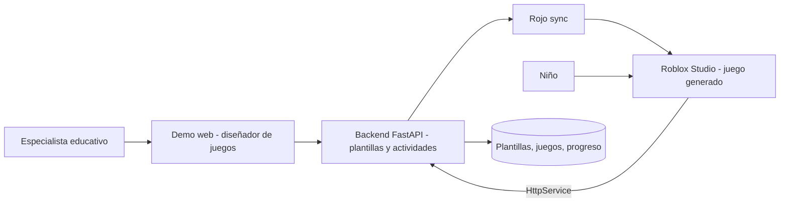
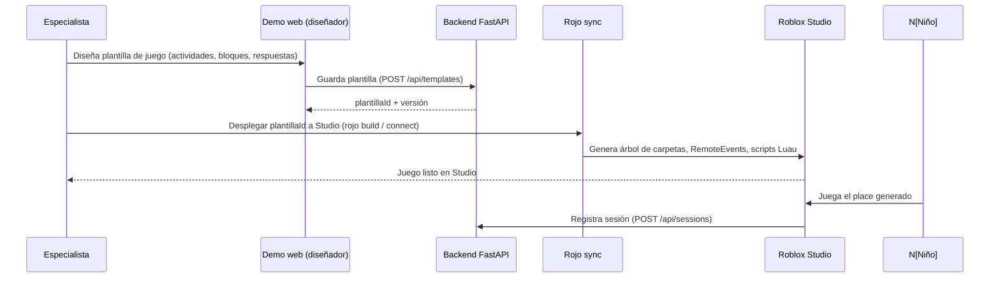
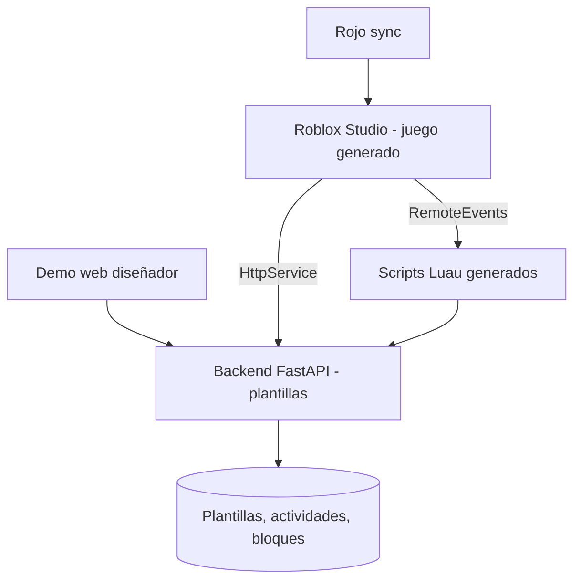
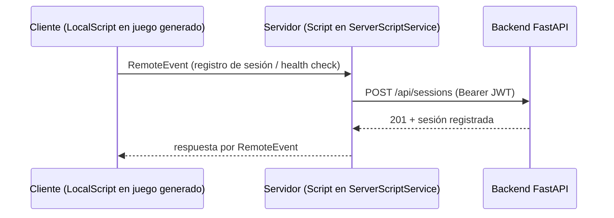

# SaIyDD — Generador de Juegos Educativos para Roblox

> Plataforma kid-safe para generar juegos educativos para niños de 4 a 8 años. Un especialista de educación diseña actividades y bloques desde una web de configuración; SAIyDD despliega la estructura del juego directamente en Roblox Studio a través de Rojo.

Repositorio: [gproatechnology/GProA_SAIyDD](https://github.com/gproatechnology/GProA_SAIyDD.git)

## Filosofía

SAIyDD no es un juego cerrado. Es un **enlace de generación**: el especialista de educación define la pedagogía (actividades, niveles, prompts, respuestas correctas, bloques interactivos) en la web de configuración, y SAIyDD genera el lugar de Roblox Studio listo para jugar. Cada plantilla publicada se convierte en un place independiente en Studio.

## Arquitectura



### Flujo de generación de juegos



## Módulos de la demo web (diseñador de juegos)

| Módulo | Responsabilidad |
|---|---|
| `app.js` | Router y coordinación del diseñador |
| `templates.js` | Crear, editar y listar plantillas de juego |
| `activities.js` | Definir actividades dentro de una plantilla |
| `blocks.js` | Diseñar bloques interactivos y pasos |
| `answers.js` | Configurar respuestas correctas y validación |
| `publish.js` | Publicar plantilla vía Rojo a Roblox Studio |
| `api.js` | Puerta de acceso al backend (mock o real) |
| `sanitize.js` | Validación y saneamiento de texto |
| `rate-limiter.js` | Límites locales por tipo de acción |

## Estructura del repositorio

```text
SAIyDD/
├── .github/
│   └── workflows/ci.yml   # CI: demo (npm) + backend (pytest + ruff)
├── LICENSE
├── README.md
├── backend/        # API FastAPI (Python) — venv, .env y *.db ignorados
│   ├── requirements.txt
│   ├── requirements-dev.txt
│   ├── .env.example
│   ├── app/        # main, auth, errors, repositories, models, schemas, seed
│   └── tests/      # pytest + httpx (TestClient)
├── demo/
│   ├── index.html
│   ├── package.json
│   ├── package-lock.json
│   ├── vite.config.js
│   └── src/
│       ├── assets/
│       │   └── images/
│       ├── css/
│       │   ├── variables.css
│       │   ├── styles.css
│       │   └── modules/
│       │       ├── screens.css
│       │       └── blocks-world.css
│       ├── js/
│       │   ├── main.js
│       │   ├── modules/
│       │   │   ├── app.js
│       │   │   ├── templates.js
│       │   │   ├── activities.js
│       │   │   ├── blocks.js
│       │   │   ├── answers.js
│       │   │   ├── publish.js
│       │   │   ├── api.js
│       │   │   ├── dashboard.js
│       │   │   ├── mascota.js
│       │   │   ├── mascota-ui.js
│       │   │   └── voz.js
│       │   ├── utils/
│       │   │   ├── sanitize.js
│       │   │   └── rate-limiter.js
│       │   └── data/
│       │       └── data.js
├── docs/
│   ├── manual-usuario.html   # Manual interactivo con búsqueda, TOC, tema
│   ├── manual.css
│   └── data.js               # Contenido y renderizado del manual
├── rojo-manager.ps1        # Gestor interactivo: Rojo + backend + despliegue de plantillas
└── rojo/
    ├── shared/               # init.lua: contrato compartido genérico (sin secretos)
    ├── server/               # main.server.lua (Script: HttpService + JWT) + secrets.lua (ignorado)
    ├── client/               # main.lua: bridge cliente (RemoteEvents)
    ├── default.project.json  # Árbol sincronizado con Studio (incluye Events)
    └── secrets.example.lua   # Plantilla de credenciales del servicio
```

## Ejecución de la demo (diseñador de juegos)

Desde la raíz del repo:

```powershell
cd demo
npm install
npm run dev
```

La demo se abre en `http://localhost:5174`.

Para generar una build de producción:

```powershell
npm run build
```

Calidad de código:

```powershell
npm run lint          # ESLint
npm run format        # Prettier (escribe)
npm run format:check  # Prettier (verifica)
npm test              # Vitest
```

## Backend (API de plantillas y juegos)

```powershell
cd backend
.venv\Scripts\python.exe -m pip install -r requirements.txt
.venv\Scripts\python.exe -m uvicorn app.main:app --host 127.0.0.1 --port 8000
```

- Auth de tutores/especialistas: `POST /api/auth/register` y `POST /api/auth/login` (bcrypt + JWT HS256, token Bearer con `role`).
- Rutas protegidas con `require_tutor` (401 sin/Con token inválido, 403 con rol insuficiente); `/api/health` y `/api/activities` son públicas.
- Endpoints de plantillas: `POST /api/templates`, `GET /api/templates/{id}`, `GET /api/templates`, `DELETE /api/templates/{id}`.
- Endpoints de actividades y bloques dentro de una plantilla.
- Endpoint de sesión: `POST /api/sessions` (registro de progreso del niño en el juego generado).
- Endpoint de borrado (derecho al olvido COPPA): `DELETE /api/children/{childId}`.
- Rate limiting con slowapi (login 10/min, registro 5/hora) y errores con formato `{"error": {"code", "message"}}`.
- Configuración vía variables de entorno (ver `backend/.env.example`), incluye `JWT_SECRET`.
- Pruebas del backend: `pytest` (pruebas con `httpx`/TestClient en `backend/tests/`); lint con `ruff`. Ambos corren en CI (job `backend`).
- La cuenta de servicio de Roblox se registra con `POST /api/auth/register` (o con la opción 8 de `rojo-manager.ps1`); sus credenciales viven en `rojo/server/secrets.lua` (ignorado por git).

## Integración con Roblox (despliegue vía Rojo)



### Flujo Studio ↔ backend



- `rojo/shared/init.lua`: contrato compartido genérico (endpoints, payloads, RemoteEvents) — sin secretos.
- `rojo/server/main.server.lua`: Script del servidor (arranca solo al abrir el place) — cliente HTTP (`HttpService:RequestAsync`), login de cuenta de servicio con cache de JWT y relogin ante 401, handlers de los RemoteEvents.
- `rojo/client/main.lua`: bridge cliente (`Client.recordSession` / `Client.healthCheck`, corrutinas con timeout).
- `rojo/server/secrets.lua`: credenciales del servicio (ignorado por git; plantilla en `rojo/secrets.example.lua`).

### Uso con `rojo-manager.ps1`

```powershell
.\rojo-manager.ps1
# [1] Iniciar servidor Rojo
# [7] Iniciar/detener backend (uvicorn :8000)
# [8] Flujo completo: cuenta de servicio + plantilla de prueba + despliegue
# [9] Estado integral (puertos, Rojo, backend, árbol sincronizado)
```

La opción 8 guarda `{apiUrl, token, templateId}` en `%TEMP%\saiydd-state.json` para la prueba manual en Studio.

### Prueba en vivo en Studio (manual)

**Requisitos de Studio:**

1. **HTTP habilitado**: Game Settings → Security → **Allow HTTP Requests = ON** (equivalente por código: `HttpService.HttpEnabled = true`; se guarda con el place y persiste en los play tests). Sin esto, `HttpService:RequestAsync` falla con `HTTP 0`.
2. **Orden de arranque**: backend (opción 7 del gestor o uvicorn) → Rojo (opción 1) → Studio: Plugins → Rojo → Connect → **Play (F5)**.

Pasos de la prueba:

1. Durante el Play, un LocalScript temporal en StarterPlayerScripts:

   ```lua
   local Client = require(script.Parent:WaitForChild("Client"))
   task.spawn(function()
       local reply = Client.recordSession("child_ID_AQUI", "act_001", 100, 90)
       print("[TEST] recordSession ->", reply.ok)
   end)
   ```

2. Verificar la persistencia compartida:

   ```powershell
   curl.exe -H "Authorization: Bearer $token" http://127.0.0.1:8000/api/children/$childId/progress
   ```

## Preparación actual

| Elemento | Estado |
|---|---|
| Demo web Vite (diseñador de juegos) | ✅ Consolidada en `demo/` |
| Documentación | ✅ Consolidada en `docs/` |
| Repositorio Git remoto | ✅ Conectado y sincronizado |
| Roblox Studio | ✅ Instalado localmente |
| Rojo (extensión + CLI) | ✅ Instalado y configurado |
| Proyecto Roblox (`default.project.json`) | ✅ Completado |
| Servicio Roblox (Luau + RemoteEvents) | ✅ Contrato genérico, cliente HTTP, bridge y play test validado |
| Backend + auth de tutores | ✅ SQLModel, bcrypt + JWT, tests y CI |
| Pruebas, linting y CI | ✅ Completados (Vitest, Pytest, Ruff, ESLint) |
| Accesibilidad y seguridad productiva | ✅ 8.1 auditoría, 8.2 accesibilidad, 8.3 moderación/consentimiento, 8.4 COPPA completados |
| Despliegue vía Rojo a Studio | ✅ Verificado end-to-end |
| Publicación cloud producción | 📋 8.6 documentado, pendiente de ejecutar |

La sincronización Rojo, el backend y la integración Studio ↔ backend están verificados (`rojo build`, `rojo serve`, flujo API de extremo a extremo), incluyendo la prueba de Play en Studio con registro real de sesión en el backend.

## Seguridad y alcance

- Los datos de plantillas y juegos se almacenan en el backend (SQLite en desarrollo, PostgreSQL en producción).
- El progreso del niño se guarda en la base de datos del backend; la demo web puede usar `localStorage` como caché local.
- Las actividades y respuestas son predefinidas por el especialista; no hay generación libre de contenido.
- La voz depende de APIs nativas del navegador y puede no estar disponible en todos los entornos.
- El PIN del panel de padres se configura con la variable de entorno `VITE_SAIYDD_PIN` (ver `demo/.env.example`); el valor por defecto es solo para demo y no debe usarse en producción.
- La API del backend protege las rutas con JWT (registro/login con bcrypt, rate limiting con slowapi, errores estandarizados); el secreto se configura con `JWT_SECRET` (ver `backend/.env.example`).
- La integración Roblox usa una cuenta de servicio de tutor: las credenciales viven en `rojo/server/secrets.lua` (ignorado por git) y el JWT solo existe en ServerScriptService, nunca en el cliente.
- Antes de una publicación real se deben completar validaciones de seguridad, accesibilidad, moderación, consentimiento y privacidad infantil.

## Roadmap

1. ✅ Consolidar en este repositorio la demo, documentación y configuración compartida.
2. ✅ Corregir los hallazgos críticos de seguridad (PIN externalizado + fuga de datos cerrada).
3. ✅ Añadir pruebas automatizadas (Vitest), linting (ESLint + Prettier), accesibilidad y CI (GitHub Actions).
4. ✅ Instalar extensión Rojo + CLI y crear `default.project.json` + estructura Luau.
5. ✅ Sincronizar Roblox Studio con Rojo (live sync verificado + `rojo build` funcional).
6. ✅ Backend: persistencia SQLModel, auth de tutores (bcrypt + JWT), integración demo↔backend, tests y CI.
7. ✅ Roblox Studio ↔ backend vía Rojo (contrato, cliente HTTP con JWT, RemoteEvents, `rojo-manager.ps1` extendido). Play test en Studio validado end-to-end.
8. 🟡 Preparación para producción (en progreso):
   - **8.1 ✅ Auditoría de seguridad técnica**: CORS, JWT, rate limiting, secretos Luau y endpoints protegidos documentados en `docs/SECURITY_REVIEW.md`.
   - **8.2 ✅ Accesibilidad**: skip-links, navegación por teclado, roles semánticos y aria-labels implementados en demo web y manual.
   - **8.3 ✅ Moderación y consentimiento**: modelo "walled garden", guardrails de entrada, flujo de consentimiento parental en dashboard y derecho al olvido documentados en `docs/CONSENTIMIENTO_Y_MODERACION.md`.
   - **8.4 ✅ Privacidad infantil (COPPA)**: política explícita de retención, minimización y borrado de datos documentada en `docs/PRIVACY_POLICY.md`. Endpoint `DELETE /api/children/{childId}` para derecho al olvido.
   - **8.5 ✅ Validación demo web contra backend real**: prueba completa en vivo con `VITE_SAIYDD_API_URL` y token.
   - **8.6 📋 Publicación y entorno cloud para Roblox**: configuración de dominio HTTPS de producción y gestión segura de secretos fuera de localhost. Requisitos detallados en "Despliegue en producción (8.6)".

## Despliegue en producción (8.6)

Esta sección documenta los requisitos para llevar SaIyDD a un entorno de producción real, fuera de `localhost`.

### 1. Backend (FastAPI)

| Requisito | Detalle |
|---|---|
| **Hosting cloud** | Desplegar en Render, Railway, Fly.io, AWS Elastic Beanstalk, Google Cloud Run, Azure App Service o similar. No ejecutar en `localhost`. |
| **Puerto** | Escuchar en el puerto asignado por el proveedor (variable `$PORT`), no fijo en `:8000`. |
| **Base de datos** | Migrar de SQLite (`saiydd.db`) a PostgreSQL gestionada (AWS RDS, Google Cloud SQL, Supabase, Neon, etc.). Ajustar `DATABASE_URL` en variables de entorno. |
| **Variables de entorno** | `JWT_SECRET` (secreto fuerte, rotación periódica), `DATABASE_URL`, `CORS_ORIGINS` (dominio del demo web), `ACCESS_TOKEN_EXPIRE_MINUTES`. |
| **Dominio HTTPS** | Dominio con certificado SSL/TLS válido (ej. `https://api.saiydd.example.com`). Roblox `HttpService` requiere HTTPS para solicitudes externas en producción. |
| **CORS** | Configurar `allow_origins` con el dominio del demo web en producción (no `*`). |
| **Rate limiting** | `slowapi` ya configurado (login 10/min, registro 5/hora). Revisar límites para tráfico real. |
| **Logs y monitoreo** | Logging estructurado, health check `/api/health` público, alertas ante caídas del servicio. |

### 2. Demo web (diseñador de juegos, Vite)

| Requisito | Detalle |
|---|---|
| **Build de producción** | `npm run build` en `demo/`; salida en `dist/`. |
| **Hosting estático** | Vercel, Netlify, GitHub Pages, AWS S3+CloudFront, Firebase Hosting o similar. |
| **Dominio HTTPS** | Dominio propio con SSL (ej. `https://saiydd.example.com`). |
| **Variables de entorno de build** | `VITE_SAIYDD_API_URL=https://api.saiydd.example.com`, `VITE_SAIYDD_API_TOKEN` (solo si el frontend necesita llamar rutas protegidas directamente; preferiblemente no exponga tokens de servicio), `VITE_SAIYDD_PIN`. |
| **No expongas secretos** | El token de la cuenta de servicio de Roblox **no** debe ir al frontend. Solo el tutor autenticado lo usa. |

### 3. Integración Roblox Studio ↔ backend (producción)

| Requisito | Detalle |
|---|---|
| **HTTP en Studio** | `Allow HTTP Requests = ON` en Game Settings → Security (persistido en el place publicado). |
| **secrets.lua en producción** | Las credenciales de la cuenta de servicio (email/password) viven en `rojo/server/secrets.lua` (ignorada por git). Configurarlas de forma segura en el entorno del desarrollador que sincroniza el place. |
| **JWT en servidor Luau** | El servidor hace login contra `https://api.saiydd.example.com/api/auth/login`, cachea el token y relogin ante 401. |
| **RemoteEvents** | Apuntan al backend HTTPS en producción. |
| **Place publicado** | Sincronizar scripts vía Rojo (`rojo build`) y publicar el place en Roblox. |

### 4. Seguridad y cumplimiento (producción)

| Requisito | Detalle |
|---|---|
| **JWT secreto** | `JWT_SECRET` nunca se commitea al repo; se inyecta como variable de entorno en el proveedor cloud. |
| **secrets.lua ignorado** | `rojo/server/secrets.lua` sigue en `.gitignore`; se provee por separado a quien despliegue en Studio. |
| **HTTPS obligatorio** | Tanto el backend como el demo web deben servir solo por HTTPS. |
| **COPPA (8.4 completado)** | El endpoint `DELETE /api/children/{childId}` sigue disponible en producción para derecho al olvido. |
| **PIN de padres** | `VITE_SAIYDD_PIN` configurado con un valor seguro en producción (no el default de demo). |

### 5. Despliegue y CI/CD

| Elemento | Detalle |
|---|---|
| **CI existente** | `.github/workflows/ci.yml` ejecuta demo (npm) + backend (pytest + ruff). Mantener y ampliar si se añaden despliegues automáticos. |
| **Despliegue backend** | GitHub Actions o pipelines del proveedor cloud para desplegar ante cambios en `main`. |
| **Despliegue demo** | Despliegue automático de `dist/` al hosting estático ante cambios en `demo/`. |
| **Despliegue Roblox** | Rojo CLI (`rojo build`) para sincronizar al place publicado; manual o scriptable desde el desarrollador. |
| **Rollback** | Plan para revertir versión del backend si falla el despliegue. |

### 6. Cambios de código necesarios para producción

1. **`backend/app/config.py`**: leer `DATABASE_URL` de variables de entorno y soportar PostgreSQL.
2. **`backend/app/database.py`**: ajustar `create_engine` para PostgreSQL si es necesario (args de conexión distintos a SQLite).
3. **`backend/.env.example`**: agregar variables de producción (`DATABASE_URL`, `CORS_ORIGINS`, etc.).
4. **`demo/.env.example`**: documentar `VITE_SAIYDD_API_URL` con ejemplo de dominio HTTPS.
5. **`README.md`**: documentar pasos de despliegue en producción (esta sección).

---

## Manual de usuario

Abrir `docs/manual-usuario.html` en el navegador (o servir con `npx serve docs`). Incluye:

- Tabla de contenidos navegable
- Búsqueda en tiempo real
- Tema claro/oscuro persistente
- Secciones: introducción, acceso, diseñador de juegos, plantillas, actividades, bloques, despliegue a Studio, seguridad, alcance, FAQ, soporte

---

## Licencia

Ver [LICENSE](LICENSE).